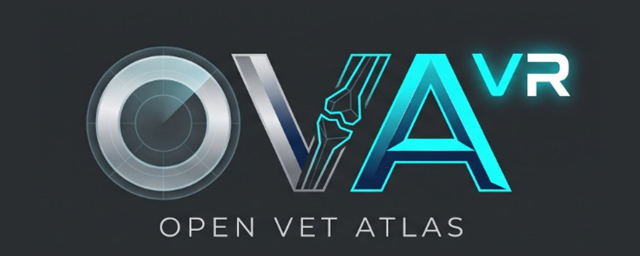
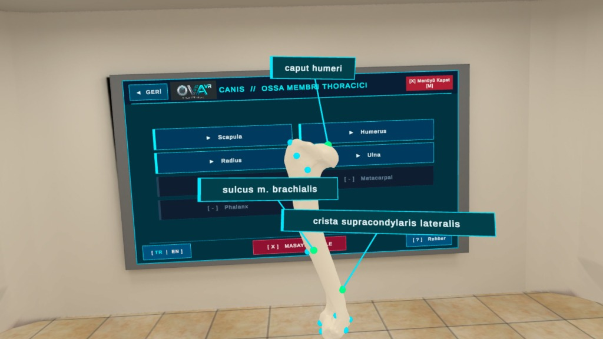
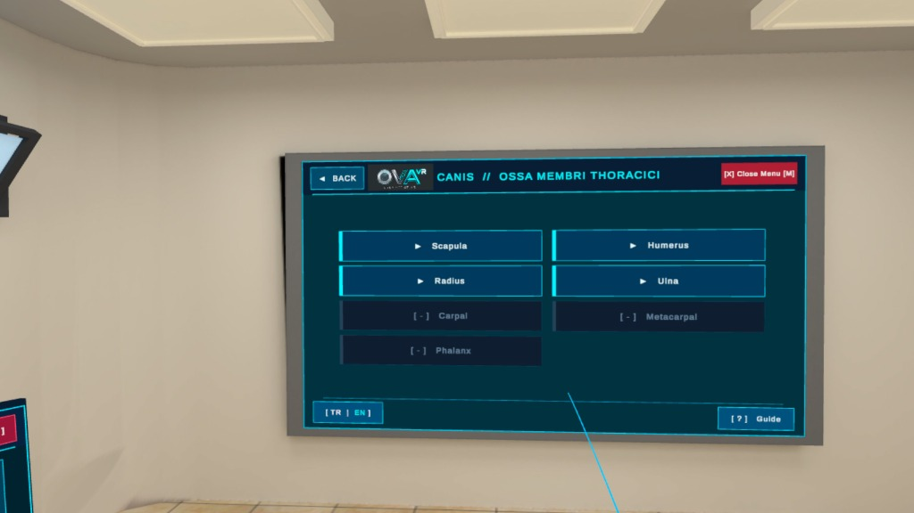
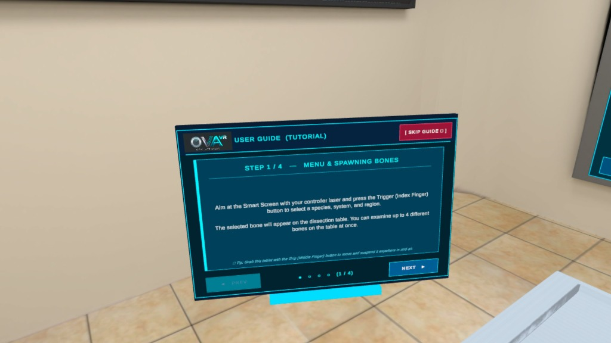
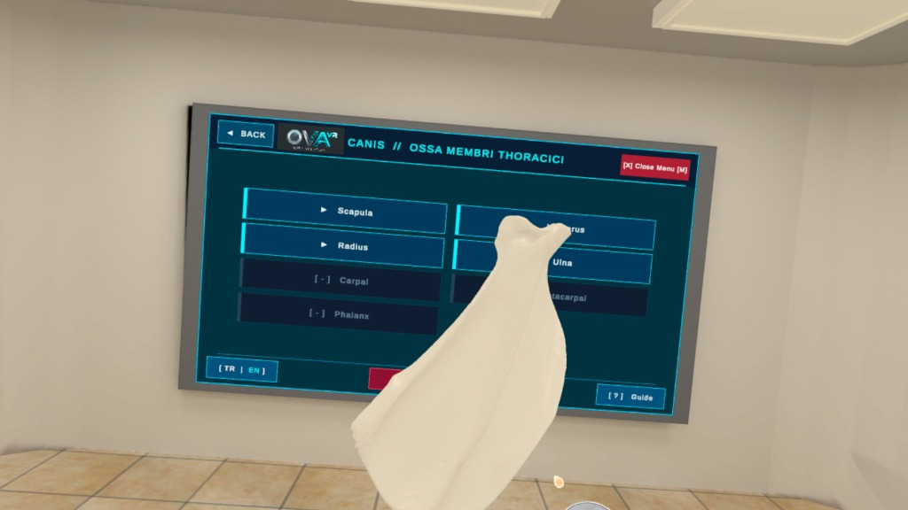
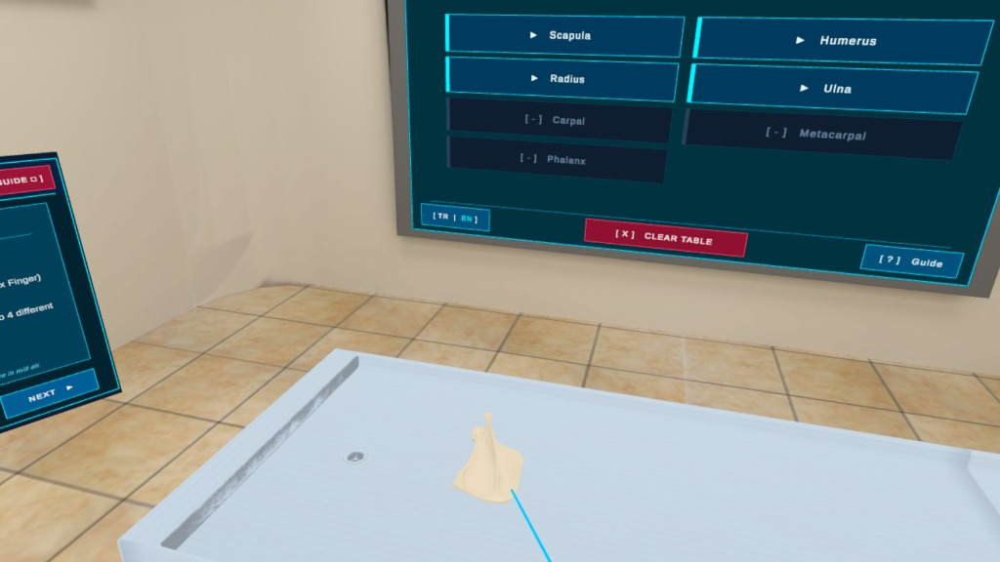

  

<h1 align="center">OpenVetAtlas VR (oVa)</h1>

  <b>Open-Source Virtual Reality Veterinary Anatomy & Osteology Platform for Meta Quest (Unity / URP)</b> 
  <i>Meta Quest İçin Açık Kaynaklı Sanal Gerçeklik Veteriner Anatomi ve Osteoloji Platformu</i>

  
  
  
  

---

## 📸 In-App Screenshots / Uygulama İçi Görseller

  
   
  <i><b>3D Holographic Anatomical Landmarks (Pin System):</b> Interactive camera-facing Latin anatomical label cards (Caput humeri, Sulcus m. brachialis, Crista supracondylaris lateralis) on a canine humerus suspended in mid-air.</i>

<table align="center">
  <tr>
    <td align="center" width="50%">
       
      <b>Smart Screen UI & Bilingual Switch (<code>[ TR | EN ]</code>)</b> 
      <i>Akıllı Menü (Canis // Ossa Membri Thoracici) ve Dil Geçişi</i>
    </td>
    <td align="center" width="50%">
       
      <b>Floating 3D Grabbable Tutorial Tablet</b> 
      <i>Havada Asılı Duran ve Grip Tuşuyla Taşınabilen 3B Rehber Tableti</i>
    </td>
  </tr>
  <tr>
    <td align="center" width="50%">
       
      <b>360° Zero-G Mid-Air Specimen Inspection (<i>Scapula</i>)</b> 
      <i>Havada Asılı Kalma (Zero-G) ve 360° Yakın İnceleme</i>
    </td>
    <td align="center" width="50%">
       
      <b>Dissection Table, Laser Interaction & Guide Tablet</b> 
      <i>Diseksiyon Masası, Lazer Etkileşimi ve Akıllı Ekran</i>
    </td>
  </tr>
</table>

---

## 🌐 English

**Open-Source Virtual Reality Veterinary Anatomy and Osteology Platform for Meta Quest (Unity / URP)**

OpenVetAtlas VR (oVa) is an open-source, virtual reality (VR) based anatomy platform developed to support three-dimensional learning in veterinary medical education.

The development process of this project utilized the **DijiLab** infrastructure, which was established by the **Department of Veterinary Anatomy, Faculty of Veterinary Medicine** and supported by **ADÜ-BAP**.

### ✨ Features
* **High-Precision 3D Digital Twins:** Highly accurate 3D digital twins scanned from real anatomical specimens.
* **Meta Quest 90 FPS Optimization:** Optimized working environment targeting 72–90 FPS performance for Meta Quest (Android / URP / ASTC) devices with pre-baked collision meshes and unlit shaders.
* **360° Inspection & Zero-G Suspension:** Detailed 360-degree analysis of bones through far and near interaction (Direct & Distance Grab). Bones released in mid-air remain suspended for effortless multi-angle inspection; pushing/pulling your arm moves the bone further or closer.
* **3D Holographic Anatomical Landmarks (Pins):** Press **X** (Left) or **A** (Right) to toggle interactive 3D anatomical pins on the bone surface (*Caput humeri, Fossa olecrani, Fossa supraspinata*, etc.). Aim the laser at any pin dot and pull the **Trigger** to open/close its camera-facing Latin label card, powered by *Pre-Baked Surface Normals*.
* **Grabbable 3D Tutorial Tablet:** A floating interactive guide tablet suspended in mid-air that can be grabbed and repositioned anywhere using the **Grip** button, or reopened anytime via the **`[ ? ] Guide`** button.
* **Bilingual Interface (`[ TR | EN ]`):** Instant one-click language switching between Turkish and English across the entire application UI and tutorial tablet while preserving Latin anatomical terminology (*Nomina Anatomica Veterinaria*).
* **Smart Menu (Smart UI):** 4-level hierarchical menu (*Species → System → Region → Bone*) operable via laser (raycast) and direct touch (poke) controls.
* **Dynamic Memory Management (Addressables & FIFO Queue):** An optimization architecture that prevents RAM bloat by allowing a maximum of **4 unique bones** in the scene simultaneously (max 1 instance per bone type), loading models dynamically at runtime. Also supports instant single-bone deletion by clicking the thumbstick button (**L3 / R3**) while holding a bone.
* **Modular Anatomy Structure:** An infrastructure that includes canine (*Canis*) forelimb bones (*Scapula, Humerus, Radius, Ulna*) in the initial phase, structured for the seamless integration of *Equide*, *Ruminant*, and *Sus* species and systems.

### 🎮 VR Controls (Meta Quest 3 / 3S / 2)

| Control / Button | Action |
| :--- | :--- |
| **Trigger (Index Finger)** | Click UI buttons & Open/Close 3D Anatomical Pin cards |
| **Grip (Middle Finger)** | Grab & inspect bones (or reposition the 3D Tutorial Tablet) |
| **Push / Pull Arm (While Grabbing)** | Move the held bone further away or closer to you |
| **X (Left) / A (Right) Button** | Toggle 3D Holographic Anatomical Landmarks (Pins) on/off |
| **L3 / R3 (Thumbstick Click while Holding)** | Immediately delete the bone held in that hand |
| **Left / Right Thumbstick** | Walk in the laboratory (Left) / Turn camera view (Right) |

### 🛠️ Build & Auto-Versioning
1. Open the project in **Unity 6 (`6000.0+`)** with Android Build Support installed.
2. For automatic scene & prefab setup: **`Tools -> Anatomi VR -> Otomatik Sistem Kurulumu`**
3. For building an auto-versioned Meta Quest APK (`OpenVetAtlas_VR_V2.apk`, `V3`, ... with automatic Addressables compilation and `bundleVersionCode` increment):
   **`Tools -> OpenVetAtlas -> Build APK (Auto-Version)`**

### 📜 License and Copyright (IMPORTANT)
The software architecture and source code of this project are open-sourced under the **GNU Affero General Public License v3.0 (AGPL-3.0)**.

**However;** **all 3D anatomical models (`.fbx`, `.obj`, etc.) and textures** included in this project were produced within DijiLab and are protected under the **Creative Commons Attribution-NonCommercial-ShareAlike 4.0 (CC BY-NC-SA 4.0)** license. These 3D models can in no way be **used for commercial purposes, sold, or integrated into a closed-source commercial product.**

---
*Developers:* Eren Özgürcan Yavaş, Fatih Gürler, Halilibrahimefe Özcan

---

## 🇹🇷 Türkçe

**Meta Quest İçin Açık Kaynaklı Sanal Gerçeklik Veteriner Anatomi ve Osteoloji Platformu (Unity / URP)**

OpenVetAtlas VR (oVa), veteriner hekimliği eğitiminde üç boyutlu öğrenmeyi desteklemek amacıyla geliştirilmiş, sanal gerçeklik (VR) tabanlı açık kaynaklı bir anatomi platformudur.

Bu projenin geliştirme sürecinde, **ADÜ-BAP** tarafından desteklenen ve **Veteriner Fakültesi Anatomi Anabilim Dalı**'nca kurulan **DijiLab** altyapısı kullanılmıştır.

### ✨ Özellikler
* **Yüksek Hassasiyetli 3D Dijital İkizler:** Gerçek anatomik piyeslerden yüksek hassasiyetle taranmış 3D dijital ikizler.
* **Meta Quest Performans Optimizasyonu:** Meta Quest (Android / URP / ASTC) cihazları için 72–90 FPS performans hedefiyle optimize edilmiş çalışma ortamı (*Prebake Collision Meshes* ve *Pre-Baked Normals*).
* **360° İnceleme ve Havada Asılı Kalma (Zero-G):** Uzaktan ve yakından etkileşim (*Direct & Distance Grab*) ile kemiklerin 360 derece detaylı analizi. Kemiği havada bıraktığınızda olduğu yerde asılı kalır; tutarken kolunuzu ileri ittiğinizde uzaklaşır, kendinize çektiğinizde yakınlaşır.
* **3B Holografik Anatomik Noktalar (Pin Sistemi):** Kumandadaki **X** (Sol) veya **A** (Sağ) tuşuna basıldığında kemik üzerindeki anatomik oluşum noktaları (*Caput humeri, Fossa olecrani, Fossa supraspinata* vb.) belirir. Lazerle istediğiniz küreciğin üzerine gelip **Tetik (Trigger)** tuşuna bastığınızda 3B Latince bilgi kartı açılır/kapanır.
* **Taşınabilir 3B Rehber Tableti:** Havada asılı duran, **Grip (Kavrama)** tuşuyla tutulup laboratuvarda istediğiniz konuma taşınabilen interaktif eğitim tableti ve ana menüdeki **`[ ? ] Rehber`** butonu.
* **Çift Dilli Arayüz (`[ TR | EN ]`):** Ana menünün sol alt köşesindeki **`[ TR | EN ]`** butonu ile tüm uygulama arayüzünü ve rehber tabletini tek tıkla Türkçe veya İngilizceye çevirme (Latince anatomik terimler sabit kalır).
* **Akıllı Menü (Smart UI):** Lazer (*raycast*) ve doğrudan dokunmatik (*poke*) kontrollerle kullanılabilen 4 kademeli (*Tür → Sistem → Bölge → Kemik*) kullanıcı arayüzü.
* **Dinamik Bellek Yönetimi (Addressables & FIFO Queue):** Sahnede her kemikten en fazla 1 adet olmak üzere aynı anda maksimum **4 kemik** barındırarak RAM şişmesini engelleyen ve modelleri çalışma anında dinamik yükleyen optimizasyon mimarisi. Ayrıca elde tutulan bir kemiği o eldeki joystick butonuna (**L3 / R3**) tıklayarak anında silme özelliği.
* **Modüler Anatomi Yapısı:** Başlangıç aşamasında köpek (*Canis*) ön bacak kemiklerini (*Scapula, Humerus, Radius, Ulna*) barındıran, ilerleyen aşamalarda yeni türlerin (*Equide, Ruminant, Sus*) ve sistemlerin entegrasyonuna uygun altyapı.

### 🎮 VR Kumanda Kontrolleri (Meta Quest 3 / 3S / 2)

| Tuş / Kontrol | İşlev |
| :--- | :--- |
| **Tetik (Trigger - İşaret Parmağı)** | Menü butonlarına tıklama ve 3B Anatomik Pin kartlarını açıp kapatma |
| **Kavrama (Grip - Orta Parmak)** | Kemikleri (veya 3B Rehber Tabletini) tutma, çevirme ve havada sabitleme |
| **Kolu İleri İtme / Çekme (Tutarken)** | Eldeki kemiği ileri uzaklaştırma veya kendine yaklaştırma |
| **X (Sol) / A (Sağ) Tuşu** | Kemik üzerindeki 3B Anatomik Noktaları (Pinleri) gösterme / gizleme |
| **L3 / R3 (Kemiği Tutarken Joystick Tıkı)** | O elde tutulan kemiği anında sahneden silme |
| **Sol / Sağ Joystick (Thumbstick)** | Laboratuvarda yürüme (Sol) ve bakış açısını döndürme (Sağ) |

### 🛠️ Kurulum ve Otomatik Versiyonlu APK Derleme
1. Projeyi **Unity 6 (`6000.0+`)** ile açın.
2. Sahne, prefab ve materyalleri otomatik yapılandırmak için: **`Tools -> Anatomi VR -> Otomatik Sistem Kurulumu`**
3. Otomatik versiyonlamalı Meta Quest APK üretmek için (`OpenVetAtlas_VR_V2.apk`, `V3`...):
   **`Tools -> OpenVetAtlas -> Build APK (Auto-Version)`**

### 📜 Lisans ve Telif Hakları (ÖNEMLİ)
Bu projenin yazılım mimarisi ve kaynak kodları **GNU Affero General Public License v3.0 (AGPL-3.0)** ile açık kaynak olarak lisanslanmıştır.

**Ancak;** proje içerisinde yer alan **tüm 3D anatomik modeller (`.fbx`, `.obj` vb.) ve kaplamalar (textures)** DijiLab bünyesinde üretilmiş olup, **Creative Commons Attribution-NonCommercial-ShareAlike 4.0 (CC BY-NC-SA 4.0)** lisansı ile korunmaktadır. Bu 3D modeller hiçbir şekilde **ticari amaçla kullanılamaz, satılamaz veya kapalı kaynaklı ticari bir ürüne entegre edilemez.**

---
*Geliştirici:* Eren Özgürcan Yavaş, Fatih Gürler, Halilibrahimefe Özcan
