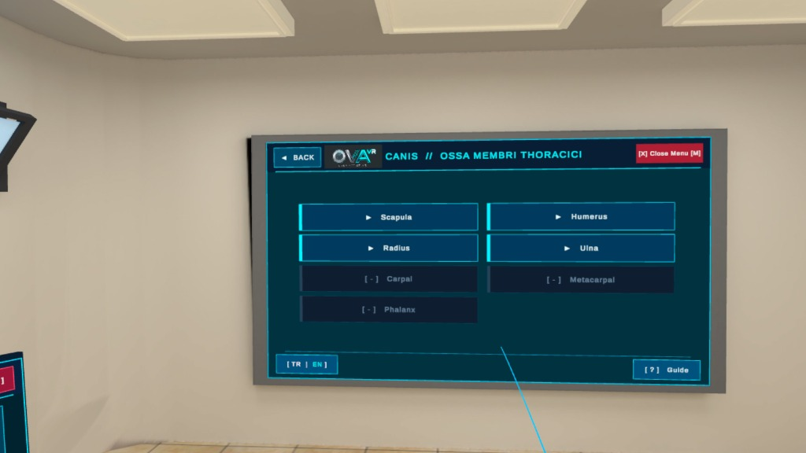
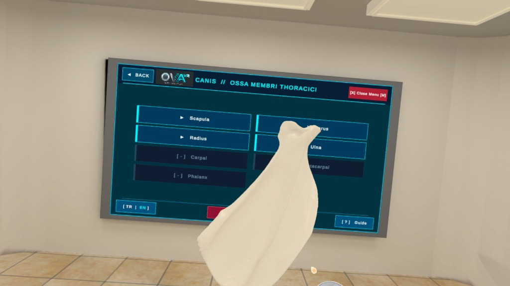
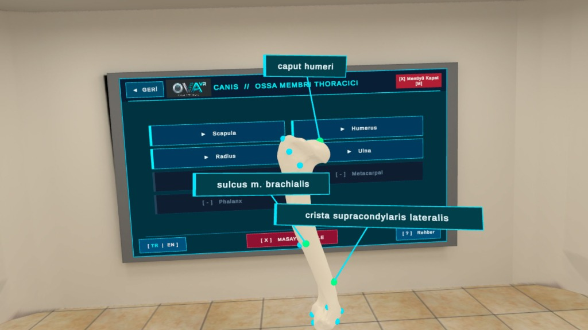
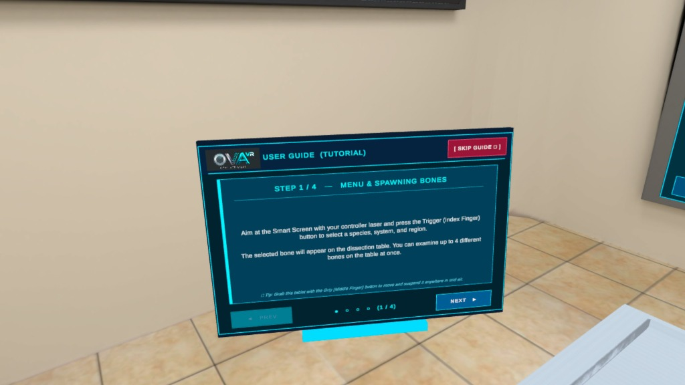

# 🎮 1. User Guide & VR Controls / Kullanıcı Rehberi ve VR Kontrolleri

This page explains how to navigate the **OpenVetAtlas VR (oVa)** virtual anatomy laboratory, manipulate 3D osteological specimens, and inspect anatomical landmarks in both **Meta Quest VR** and **PC Desktop Test Mode**.

Bu sayfa, **OpenVetAtlas VR (oVa)** sanal anatomi laboratuvarında gezinmeyi, 3B kemik modellerini incelemeyi ve anatomik oluşum noktalarını (Pin) kullanmayı hem **Meta Quest VR** hem de **PC Masaüstü Test Modu** için açıklar.

---

## 🥽 Meta Quest VR Controls / VR Kumanda Kontrolleri

  

### 1. Menu Navigation & Spawning Bones / Menü Kullanımı ve Kemik Çağırma
* **Laser Selection:** Aim your controller laser at the **Smart Screen** on the wall and press the **Trigger (Index Finger)** button to navigate through the 4-level hierarchy:
  `Species (Canis) ➔ System (Systema Skeletale) ➔ Region (Ossa Membri Thoracici) ➔ Bone (Scapula, Humerus, Radius, Ulna)`
* **Table Limit (Max 4 Bones):** Selected bones spawn above the stainless-steel dissection table. Up to **4 unique bones** can be on the table at the same time (max 1 instance of each bone). If a 5th bone is spawned, the oldest bone is automatically removed (*FIFO Queue*).
* **Clear Table:** Click **`[ X ] MASAYI TEMİZLE / CLEAR TABLE`** at the bottom center of the Smart Screen to remove all bones at once.

* **Lazerle Seçim:** Kumanda lazerinizi karşıdaki **Akıllı Ekran** menüsüne doğrultup **Tetik (İşaret Parmağı)** tuşuna basarak 4 kademeli menüde ilerleyin.
* **Masa Sınırı (Maksimum 4 Kemik):** Seçtiğiniz kemik diseksiyon masasının üzerine iner. Masada aynı anda **en fazla 4 farklı kemik** bulunabilir (aynı kemikten ikinci kez düşmez).
* **Masayı Temizle:** Masada kemik varken ekranın alt ortasında beliren **`[ X ] MASAYI TEMİZLE / CLEAR TABLE`** butonuyla tüm kemikleri tek tıkla kaldırabilirsiniz.

---

### 2. Grabbing, Zero-G Suspension & Quick Delete / Kemiği Tutma, Havada Asılı Kalma ve Silme

  

* **Grab (`Grip` - Middle Finger):** Point your laser at a bone (from a distance or up close) and hold the **Grip** button to grab it.
* **Push / Pull Distance:** While holding a bone with the Grip button, push your arm forward to move the bone further away, or pull your arm toward yourself to bring it closer.
* **Zero-G Mid-Air Suspension:** When you release the Grip button while the bone is in mid-air (at least 11 cm above the dissection table), the bone **stays suspended in mid-air** at that exact position and angle, allowing you to walk around it or inspect its landmarks hands-free.
* **Quick Single-Bone Delete (`L3` / `R3`):** While holding a bone in your left or right hand, **click the Thumbstick button (`L3` or `R3`) on that same controller** to immediately delete that specific bone from the scene.

* **Kavrama (`Grip` - Orta Parmak):** Kemikleri uzaktan veya yakından **Grip** tuşuyla tutabilirsiniz.
* **Uzaklaştırma / Yakınlaştırma:** Kemiği tutarken kolunuzu ileri iterseniz kemik uzaklaşır, kendinize çekerseniz yakınlaşır.
* **Havada Asılı Kalma (Zero-G):** Kemiği masa yüzeyinin üzerinde (havada) bıraktığınızda kemik düşmez; bıraktığınız konumda ve açıda **havada asılı kalır**.
* **Eldeki Kemiği Anında Silme (`L3` / `R3`):** Sağ veya sol kumandayla bir kemik tutarken, **tuttuğunuz eldeki Joystick butonuna (`R3` veya `L3`) tıkladığınızda** o kemik anında sahneden silinir.

---

### 3. 3D Holographic Anatomical Landmarks (Pin System) / 3B Holografik Anatomik Noktalar

  

* **Toggle Pins (`X` or `A` Button):** Press the **X** button (Left Controller) or **A** button (Right Controller) to show/hide the glowing cyan anatomical landmark spheres on the bone surface.
* **Open / Close Label Card (`Trigger`):**
  * **Cyan Sphere:** Landmark is closed.
  * **Yellow Sphere:** Laser is hovering over the landmark.
  * **Green Sphere:** Landmark card is open! Pull the **Trigger (Index Finger)** once while hovering over a sphere to toggle its 3D Latin anatomical label card (*Caput humeri, Fossa olecrani, Sulcus m. brachialis*, etc.).
* **Anti-Overlap & Camera-Facing Cards:** Multiple cards can be opened simultaneously; they automatically orient toward the user's headset and repel each other so labels never overlap or clip inside the bone.

* **Pinleri Aç / Kapat (`X` veya `A` Tuşu):** Kumandadaki **X** veya **A** tuşuna bastığınızda kemik üzerindeki anatomik oluşum noktalarında mavi holografik kürecikler belirir.
* **Bilgi Kartını Aç / Kapat (`Tetik / Trigger`):** Lazeri bir küreciğin üzerine getirdiğinizde kürecik **sarıya** döner. **Tetik** tuşuna bir kez basıp bıraktığınızda kürecik **yeşile** döner ve kameraya bakan 3B Latince isim kartı açılır.

---

### 4. Floating 3D Tutorial Tablet & Bilingual Switch / Taşınabilir Rehber Tableti ve Dil Geçişi

  

* **Grabbable 3D Tablet:** On startup, a floating 4-step **User Guide Tablet** appears to your left. You can grab it from anywhere on its frame or bottom cyan handle bar using the **Grip** button and place it anywhere in mid-air.
* **Reopen Anytime (`[ ? ] Rehber / Guide`):** If you close the tablet via `[ Skip Guide ✕ ]`, you can reopen it at any time from the bottom-right **`[ ? ] Rehber / Guide`** button on the Smart Screen.
* **Bilingual Switch (`[ TR | EN ]`):** Click the **`[ TR | EN ]`** button at the bottom-left corner of the Smart Screen to switch the entire application UI and tutorial tablet between **Turkish** and **English** instantly.

---

## 🖥️ PC / Unity Editor Test Controls / PC Test Kontrolleri

You can test all features in the Unity Editor without a VR headset using `DesktopTestController`:

| Key / Input (Tuş) | Function (İşlev) |
| :--- | :--- |
| **Right Click + Mouse** (or **Arrow Keys / Q-E**) | Look around (Etrafa bakma) |
| **W, A, S, D** (+ **Left Shift**) | Walk in the laboratory (Laboratuvarda yürüme) |
| **Left Click** or **[F]** on Bone | Grab / Release bone (Kemiği tutma / bırakma) |
| **Mouse Wheel** (While Holding) | Move bone closer / further (Kemiği yaklaştırma / uzaklaştırma) |
| **[R] + Mouse** or **Middle Click** | Rotate bone 360° in 3D (Kemiği 360° döndürme) |
| **[G]** | Toggle Zero-G mid-air suspension (Havada sabitle / bırak) |
| **[X]** or **[L]** | Toggle 3D Holographic Anatomical Pins (3B Pinleri aç / kapat) |
| **Left Click** on Pin Sphere | Open / Close 3D Latin label card (Pin bilgi kartını aç / kapat) |
| **[M]** or **[Tab]** | Open / Close Smart Screen menu (Ana menüyü aç / kapat) |
| **[C]** / **[V]** / **[H]** | Crouch (`C`), Reset camera to table (`V`), Toggle help overlay (`H`) |
