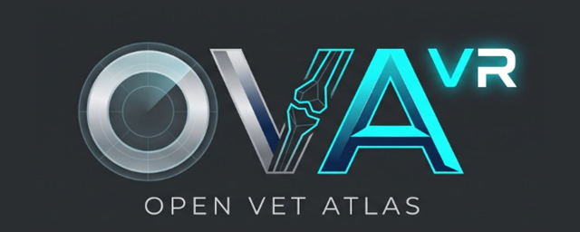

  

# OpenVetAtlas VR (oVa) — Official Wiki / Resmi Wiki

Welcome to the official documentation and developer wiki for **OpenVetAtlas VR (oVa)** — the open-source Virtual Reality Veterinary Anatomy & Osteology Platform developed at **Aydın Adnan Menderes University (ADÜ), Faculty of Veterinary Medicine, Department of Veterinary Anatomy (DijiLab)** with the support of **ADÜ-BAP**.

**OpenVetAtlas VR (oVa)** resmi dokümantasyon sayfasına hoş geldiniz. Bu platform, **ADÜ-BAP** tarafından desteklenen ve **Aydın Adnan Menderes Üniversitesi Veteriner Fakültesi Anatomi Anabilim Dalı** bünyesinde kurulan **DijiLab** altyapısı kullanılarak geliştirilmiştir.

---

## 📚 Wiki Contents / Wiki İçindekiler

1. **[🏠 Home / Genel Bakış](Home)**
   * Project vision, supported hardware, anatomical roadmap, and dual-licensing model.
   * Proje vizyonu, desteklenen donanımlar, anatomik yol haritası ve çift lisans modeli.
2. **[🎮 1. User Guide & VR Controls / Kullanıcı Rehberi ve Kontroller](1-User-Guide-and-VR-Controls)**
   * Complete Meta Quest 3 / 3S / 2 controller mapping, 3D Tutorial Tablet, Zero-G bone inspection, 3D Holographic Pins, `[ TR | EN ]` language toggle, and PC Editor test controls.
   * Meta Quest kumanda şeması, 3B Rehber Tableti, Zero-G kemik inceleme, 3B Holografik Pin kullanımı ve PC test kısayolları.
3. **[⚙️ 2. Architecture & Quest Optimization / Yazılım Mimarisi ve Optimizasyon](2-Architecture-and-Optimization)**
   * C# module structure, Addressables + 4-Bone FIFO memory management, Pre-Baked Normals, Fossa raycast hysteresis, and 90 FPS URP rendering pipeline.
   * C# modül mimarisi, Addressables + 4 Kemik FIFO bellek yönetimi, Pre-Baked Normals, Fossa seçimi algoritması ve 90 FPS URP optimizasyonları.
4. **[🦴 3. Adding New Bones & Blender Workflow / Yeni Kemik ve Pin Ekleme Rehberi](3-Adding-New-Bones-and-Blender-Workflow)**
   * How to add new scanned `.fbx` bones via the `Kemik/` folder hierarchy, Blender `Pin_` Empty workflow, and the Unity Click-to-Place Pin Editor Window.
   * Klasör hiyerarşisi ile yeni `.fbx` kemik ekleme, Blender `Pin_` iş akışı ve Unity içi Yüzeye Tıklayarak Pin Yerleştirme aracı.
5. **[📦 4. APK Build & Quest Installation / APK Derleme ve Gözlüğe Kurulum](4-APK-Build-and-Quest-Installation)**
   * Using the `AutoBuilder` (`Tools -> OpenVetAtlas -> Build APK (Auto-Version)`) and installing the APK onto Meta Quest headsets via SideQuest / MQDH.
   * Otomatik versiyonlamalı APK derleme sistemi ve Meta Quest gözlüğe kurulum adımları.

---

## 🗺️ Anatomical Content Roadmap / Anatomik İçerik Yol Haritası

| Species (Tür) | System (Sistem) | Region (Bölge) | Status (Durum) |
| :--- | :--- | :--- | :--- |
| **Canis** (Dog / Köpek) | *Systema Skeletale* | *Ossa Membri Thoracici* (*Scapula, Humerus, Radius, Ulna*) | ✅ **Active (v0.2.0-beta)** |
| **Canis** (Dog / Köpek) | *Systema Skeletale* | *Ossa Membri Thoracici* (*Carpal, Metacarpal, Phalanx*) | 🔄 Scanning / In Progress |
| **Canis** (Dog / Köpek) | *Systema Skeletale* | *Ossa Membri Pelvini, Columna Vertebralis, Skeleton Thoracis, Skeleton Axiale* | 📅 Planned |
| **Equide** (Horse / At) | *Systema Skeletale* | All Regions | 📅 Planned |
| **Ruminant** (Cattle / Sığır) | *Systema Skeletale* | All Regions | 📅 Planned |
| **Sus** (Pig / Domuz) | *Systema Skeletale* | All Regions | 📅 Planned |

---

## 👥 Project Team / Proje Ekibi
* **Eren Özgürcan Yavaş**
* **Fatih Gürler**
* **Halilibrahimefe Özcan**

*Institution / Kurum:* Aydın Adnan Menderes Üniversitesi, Veteriner Fakültesi, Anatomi Anabilim Dalı — **DijiLab**
