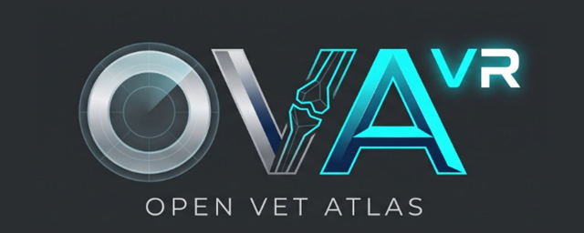

  

### 📖 OpenVetAtlas VR Wiki

* **[🏠 Home / Genel Bakış](Home)**
* **[🎮 1. User Guide & VR Controls](1-User-Guide-and-VR-Controls)**
  * *VR Kumanda & Rehber*
* **[⚙️ 2. Architecture & Optimization](2-Architecture-and-Optimization)**
  * *Mimari & 90 FPS Optimizasyon*
* **[🦴 3. Adding Bones & Pins](3-Adding-New-Bones-and-Blender-Workflow)**
  * *Yeni Kemik & Pin Ekleme*
* **[📦 4. APK Build & Installation](4-APK-Build-and-Quest-Installation)**
  * *Otomatik APK & Kurulum*

---
**Links / Bağlantılar**
* [GitHub Repository](https://github.com/eoyavas/OpenVetAtlas-VR)
* [Releases (Download APK)](https://github.com/eoyavas/OpenVetAtlas-VR/releases)
